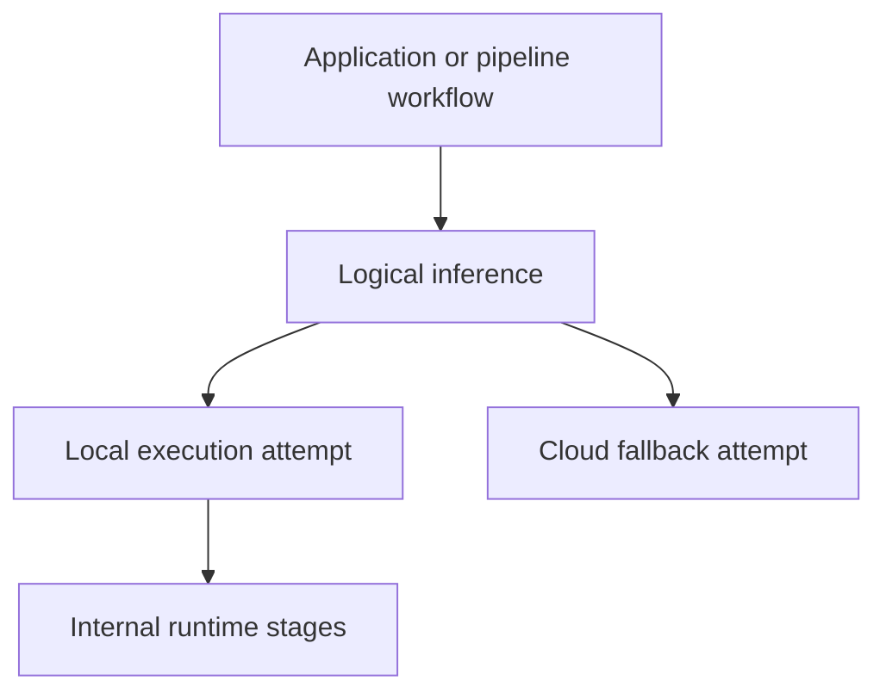

# Trace model

The supported trace model is portable OpenTelemetry instrumentation, described
in the [`xybrid-observability` contract](../../crates/xybrid-observability/CONTRACT.md).
See [SDK observability](telemetry.md) for initialization and content policy.
Legacy UUID event grouping, `TelemetryPipelineContextGuard`,
`set_telemetry_pipeline_context` and flush-time context stamping are retired.

## Logical operations and execution stages

A model call has one logical inference span. Concrete local/cloud attempts and
internal preprocessing/decoding stages are its descendants. Retries and
fallbacks describe where the same logical work executed; they do not require a
new unrelated trace. A pipeline uses an `invoke_workflow` parent for its work.
Streaming records chunks, timing and terminal usage on the logical inference;
it does not create an inference span for each token.



Not every run has multiple attempts or an enclosing workflow. Without an
explicit or ambient parent, the logical operation starts its own trace. Backend
rendering and grouping are concerns of the receiving observability product;
local event names do not define OTLP span identity.

## Context propagation

Trace IDs and span IDs follow W3C Trace Context. Context is captured when an
operation starts, rather than looked up from a mutable process-global exporter
when a queue is flushed. SDK worker hops propagate the parent, and scoped core
recorders attach internal stages and outbound trace headers to the active run.
Concurrent runs retain their own parentage.

An application can pass an incoming W3C parent through `RunOptions`:

```rust
use xybrid_sdk::{RunOptions, observability::ObservationOptions};

let observation = ObservationOptions::from_traceparent(
    "00-4bf92f3577b34da6a3ce929d0e0e4736-00f067aa0ba902b7-01",
    None, // optional tracestate
)?;
let options = RunOptions {
    observation: Some(observation.with_conversation_id("application-conversation")),
    ..RunOptions::default()
};
// Pass `options` through the normal model run API.
# Ok::<(), xybrid_sdk::SdkError>(())
```

An explicit `ObservationOptions::parent` wins over the ambient parent.
`TraceMode::Suppress` suppresses the run's trace and its SDK stage descendants;
metrics can still be recorded. Resource and trace sampling are independent.
Conversation IDs, correlation IDs and prompt references are caller-supplied
metadata; they are not trace IDs and should not contain secrets.

Direct `xybrid_core` execution does not automatically acquire an SDK observer.
A caller that bypasses the SDK must supply observation/scoped recorder plumbing;
the CLI's direct-core adapter does this. Do not restore a global legacy event
exporter to correlate those calls.

## References, feedback and evaluations

Successful `InferenceResult` values expose `observation_ref()`, containing the
trace/span reference needed by `record_feedback` and `record_evaluation`. It can
be absent when tracing is disabled or suppressed. Those reporting APIs require
a configured logs destination; the Xybrid preset configures only traces.

Pipeline results expose the workflow reference; each stage result exposes its
logical inference reference. SDK streamed-TTS results wrap the core summary and
its inference reference. Models expose an immutable `load_observation_ref()`;
reloads and lazy materialization create separate load observations under the
operation that triggered them. ASR partials carry the actual decoder execution
reference, while terminal transcription results carry the session workflow
reference. Returning a cached partial does not count another inference.

References use `{trace_id, span_id}`. A valid unsampled operation retains its
reference; explicit trace suppression has none. References identify observations
and do not prove that export succeeded. See the
[binding and execution matrix](observability-coverage.md) for surface details.

## Local capture is independent

`TelemetryEvent` subscriptions, execution listeners and core local trace capture
are in-process diagnostics. They can carry their own producer context and raw
stage data. They do not feed the OTLP exporter, and publishing a local event does
not assign it an OpenTelemetry trace. OTLP content policy does not sanitize local
event subscribers. See [SDK observability](telemetry.md#local-events-are-a-separate-surface).

Implementation: [`observability.rs`](../../crates/xybrid-sdk/src/observability.rs)
and [core scoped tracing](../../crates/xybrid-core/src/tracing.rs).
